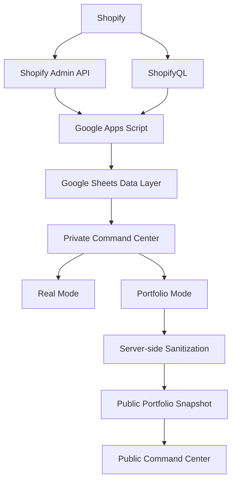

# Architecture — E-commerce Command Center

## Simple explanation

1. Shopify is the main data source.
2. ShopifyQL provides analytics data.
3. The Admin API provides operational data.
4. Google Apps Script collects and processes the information.
5. Google Sheets works as the data layer.
6. The private dashboard can use Real Mode or Portfolio Mode.
7. The public dashboard only receives sanitized Portfolio data.
